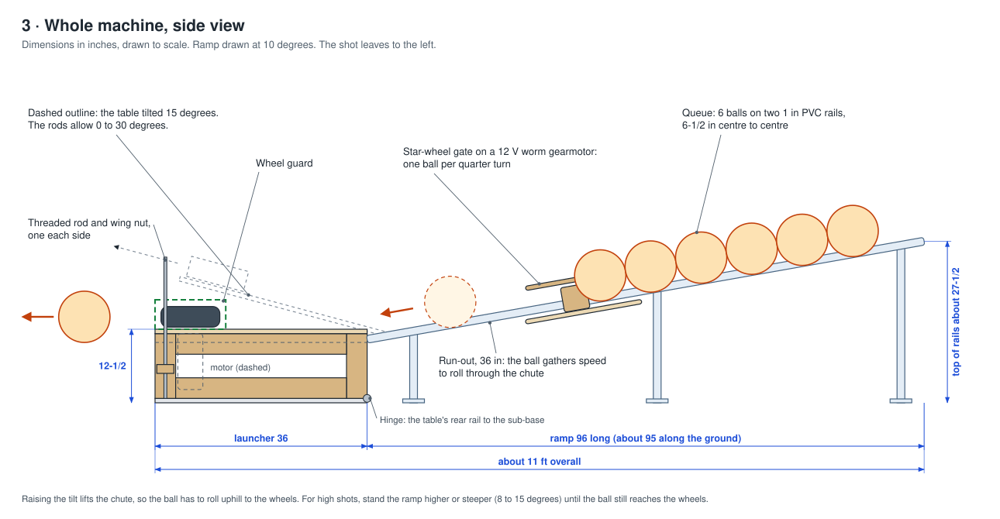
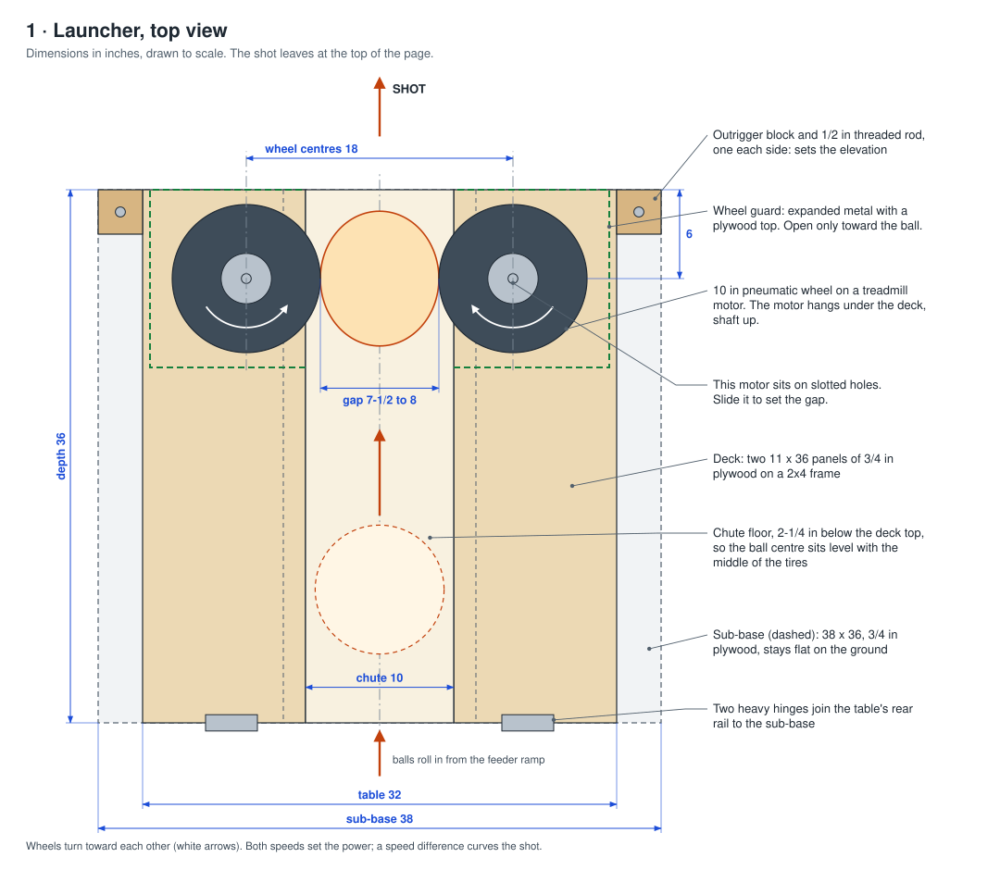
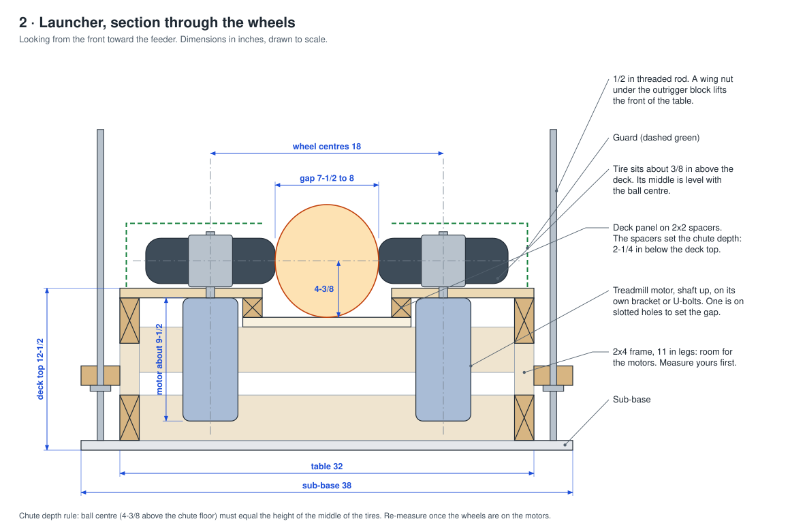
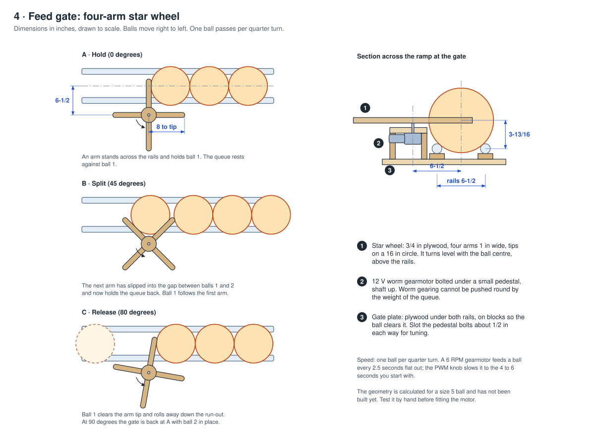
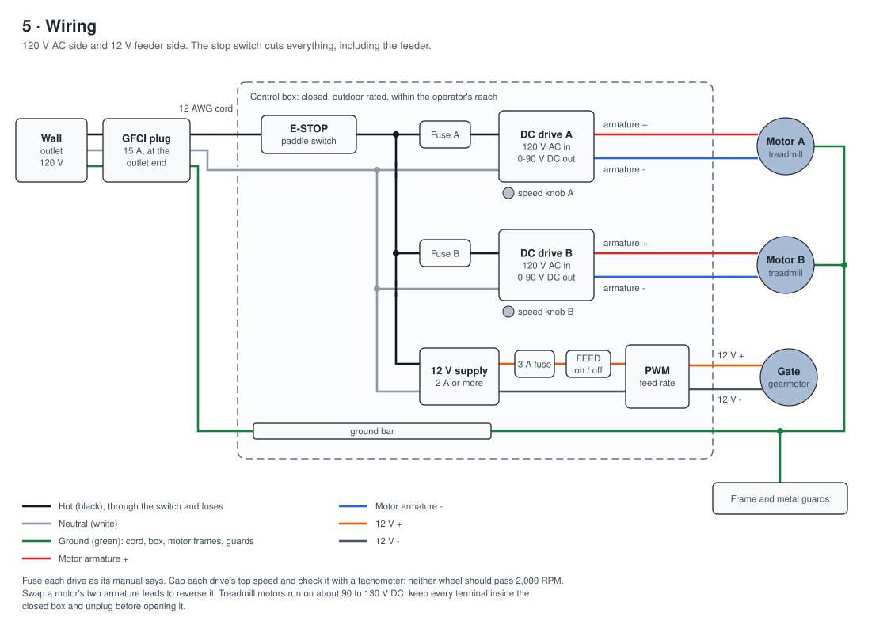

# DIY Two-Wheel Soccer Ball Launcher (with Auto Feeder)

A two-wheel soccer ball launcher built from used treadmill motors, pneumatic wheels and plywood, with a gravity ramp and a star-wheel gate that feeds balls automatically. Designed for goalkeeper training.

> **Status:** Design only. Nothing here has been built or tested yet. Dimensions that depend on your salvaged motors are marked "measure yours".

- **Drawings:** [docs/diagrams](docs/diagrams) (five SVGs, redrawn by `python3 docs/diagrams/draw.py`)
- **Parts list and cost:** [docs/parts-and-cost.md](docs/parts-and-cost.md)

---

## Table of Contents
1. [Safety First](#safety-first)
2. [Specifications](#specifications)
3. [How It Works](#how-it-works)
4. [Parts and Cost](#parts-and-cost)
5. [Layout & Dimensions](#layout--dimensions)
6. [Build Steps — Launcher](#build-steps--launcher)
7. [Build Steps — Auto Feeder](#build-steps--auto-feeder)
8. [Wiring](#wiring)
9. [Tuning & Operation](#tuning--operation)
10. [What Changed From the First Draft](#what-changed-from-the-first-draft)
11. [Future Upgrades](#future-upgrades)

---

## Safety First

- **Cap the wheel speed.** Treadmill motor labels run from about 3,000 to 5,100 RPM at full voltage. On a 10 in wheel that is roughly 90 to 150 mph at the tire. Limit each drive so neither wheel can pass **2,000 RPM** (about 60 mph), and check it with a tachometer.
- **Guard both wheels.** Only the ball gap should be open.
- **Stop switch within reach** of the operator at all times. It cuts the wheels and the feeder. The wheels keep coasting after power is cut, so wait for them to stop.
- **Use a GFCI.** This is 120 V equipment on grass.
- **Start slow.** A two-wheel launcher can throw harder than a human kick.
- **Load from behind only.** Never reach near the wheels while they spin.
- **High-voltage DC.** Treadmill motors run on about 90 to 130 V DC. Enclose all wiring, ground the frame, and follow the drive's wiring diagram exactly.
- **No pneumatic/air-cannon designs.** Pressurized PVC can shatter.
- Keeper should wear full gear (gloves, shin guards). Set the feed interval generously at first.

---

## Specifications

| Item | Spec |
|---|---|
| Ball | Size 5 soccer ball (8.6 to 8.8 in diameter) |
| Launch method | Two counter-rotating pneumatic wheels, lying flat |
| Wheels | 2 × 10 in pneumatic (hand-truck style) |
| Wheel gap | 7-1/2 to 8 in, set by sliding one motor on slotted holes |
| Wheel centres | 18 in apart, 6 in back from the front edge |
| Motors | 2 × used treadmill DC motors, about 90 to 130 V, hung under the deck, shaft up |
| Motor control | 2 × DC drives with 120 V AC input, one per wheel |
| Speed cap | 2,000 RPM per wheel, about 60 mph at the tire |
| Spin / curve | Run the wheels at different speeds |
| Table | 32 × 36 in deck (two 11 in panels and a 10 in chute), 12-1/2 in high on a 2×4 frame |
| Chute | Floor 2-1/4 in below the deck top |
| Elevation | Rear hinge to a 38 × 36 in sub-base, two 1/2 in threaded rods, 0 to 30° |
| Feeder | Two 1 in PVC rails, 96 in long, 8 to 15° slope, 6 balls queued |
| Feed gate | Four-arm star wheel on a 12 V, 6 RPM worm gearmotor: one ball per quarter turn |
| Feed interval | 2.5 s flat out; start at 4 to 6 s |
| Power | One 120 V outlet through a GFCI; 12 V supply for the feeder |
| Footprint | About 11 ft long with the ramp |
| Estimated cost | About $465 plus two used treadmills, or $910 to $1,180 buying motors and drives. See [parts and cost](docs/parts-and-cost.md). |

---

## How It Works

1. Balls sit single-file on a sloped PVC ramp behind the launcher.
2. A star-wheel gate lets **one ball through per quarter turn**.
3. The ball rolls down a 36 in run-out, into the chute, and into the gap between the wheels.
4. The wheels squeeze and fling the ball forward. Wheel speed sets the power; a speed difference curves the shot.

---

## Parts and Cost

The full list, with quantities, prices seen and where, is in [docs/parts-and-cost.md](docs/parts-and-cost.md). In short:

| Route | Total |
|---|---|
| Salvage the motors and control boards from two used treadmills | about $465, plus the treadmills |
| Buy used motors and used MC-60 boards | about $910 to $1,080 |
| Buy used motors and new KBIC-120 drives | about $1,035 to $1,180 |

---

## Layout & Dimensions

- **Width:** the two wheels and the gap span 28 in, so the table is 32 in wide. The sub-base is 38 in wide so the elevation rods stand clear of the table.
- **Chute depth:** the ball centre is 4-3/8 in above the chute floor and must be level with the middle of the tires. With a 3-1/2 in wide tire sitting 3/8 in above the deck, that puts the chute floor 2-1/4 in below the deck top: one 2×2 spacer plus the 3/4 in deck. Re-measure once the wheels are on the motors and shim the spacers to suit.
- **Motor room:** a treadmill motor hung shaft-up needs about 9-1/2 in under the deck. The frame has 11 in legs. Measure yours.

---

## Build Steps — Launcher

1. **Cut the plywood and 2×4s** from the cut lists in [parts and cost](docs/parts-and-cost.md).
2. **Build two side frames.** Each is two 11 in legs joined by a 29 in rail at the top and one at the bottom.
3. **Join the side frames** with four 29 in cross rails: two at the bottom, and two with their tops 2-1/4 in below the tops of the legs. The chute floor rests on the upper pair.
4. **Make the chute.** Glue and screw a 2×2 spacer along each long edge of the 13 in chute floor, leaving 10 in between them. Set it on the upper cross rails.
5. **Fit the deck panels** on the side rails and the spacers, leaving the 10 in chute open down the middle.
6. **Mark the wheel centres** 18 in apart (9 in each side of the centre line) and 6 in back from the front edge. Drill the shaft holes. Slot the holes for one motor.
7. **Hang the motors** under the deck, shaft up, on their own brackets or U-bolts.
8. **Fix the wheels to the shafts.** A hand-truck wheel spins on its bearings, so lock it to the shaft, usually by bolting the rim to the treadmill's flywheel. The tire should sit about 3/8 in above the deck.
9. **Set the gap** to 7-1/2 to 8 in between the tires. A ball should need firm pressure to pass through.
10. **Add the guards.** Enclose both wheels and leave only the ball path open.
11. **Add the tilt.** Hinge the table's rear rail to the sub-base. Screw an outrigger block to each front leg and stand a threaded rod through it; a wing nut under the block lifts the front. Drill the rod holes oversize so the rods can lean as the table tilts.

---

## Build Steps — Auto Feeder

1. **Rails.** Two 1 in PVC rails, 6-1/2 in centre to centre, 96 in long. The ball rides between them.
2. **Legs.** Three leg frames from PVC tees. Join each pair of legs below the rails, not between them: the ball hangs about 1/2 in below the rail centres.
3. **Slope.** Set the legs so the rails drop 8 to 15° and end level with the chute floor.
4. **Gate plate.** Fix a 17 × 20 in plywood plate under both rails, 36 in up from the lower end, on blocks so the ball clears it.
5. **Star wheel.** Cut a four-arm star from 3/4 in plywood: arms 1 in wide, tips on a 16 in circle, ends rounded.
6. **Gearmotor.** Bolt the gearmotor under a small pedestal on the plate, shaft up, with the shaft 6-1/2 in from the ramp's centre line. The star turns level with the ball centre. Slot the pedestal bolts about 1/2 in each way.
7. **Test by hand.** Turn the star slowly with a full queue. Exactly one ball should pass per quarter turn, and the next arm should slip between the first two balls without pinching either. Move the pedestal or trim the tips until it does.

---

## Wiring

- The GFCI goes at the outlet end. The stop switch breaks the hot wire to everything.
- Each drive has its own fuse, sized from the drive's manual.
- Drives, fuses, the 12 V supply and every terminal sit inside one closed box.
- Ground the box, both motor frames and the metal guards.
- Swap a motor's two armature leads to reverse it. The wheels must turn **toward each other**.
- The feeder has its own switch so you can pause feeding while the wheels spin.

---

## Tuning & Operation

**Set the speed cap first.** With a tachometer on each wheel, turn the knob to full and adjust the drive's maximum-speed trim until the wheel reads 2,000 RPM. If the drive has no such trim, fit a fixed resistor in series with the top of the speed knob, or a stop on the knob.

| Tire speed | Wheel RPM (10 in wheel) |
|---|---|
| 30 mph | 1,000 |
| 40 mph | 1,350 |
| 50 mph | 1,700 |
| 60 mph | 2,000 |

The ball leaves a little slower than the tire.

| Goal | Adjustment |
|---|---|
| Softer shots | Lower both wheel speeds |
| Harder shots | Raise both wheel speeds, gradually |
| Curve left/right | Run one wheel faster than the other |
| Ground balls | Table flat (0°) |
| High balls / crosses | Raise the front with the threaded rods |
| Ball stalls in the chute at a high tilt | Stand the ramp higher or steeper |
| Ball jams in the gap | Widen the gap slightly or check tire pressure |
| Weak / inconsistent shots | Narrow the gap slightly; match tire pressure on both wheels |
| Feed too fast/slow | Turn the feeder's PWM knob |
| Two balls feed at once | Move the gate pedestal or trim the star tips |

**Startup checklist**
1. Area clear; keeper in position and ready.
2. Guards on, box closed, GFCI tested.
3. Wheels on at **low** speed.
4. Feeder on; confirm the interval.
5. Increase speed gradually.

**Shutdown:** Feeder off → wheels off → stop switch → wait for the wheels to stop → unplug.

---

## What Changed From the First Draft

| First draft | Now | Why |
|---|---|---|
| Base 24 in wide | Table 32 in, sub-base 38 in | Two 10 in wheels and an 8 in gap are 28 in across. |
| 2×4 frame under the board | Frame with 11 in legs | A motor hung shaft-up is about 9-1/2 in long. |
| Chute on the deck | Chute floor 2-1/4 in below the deck | The ball centre has to line up with the middle of the tires. |
| Two-arm paddle, one ball per half turn | Four-arm star wheel, one ball per quarter turn | With two arms there is a moment when neither blocks the ramp, so the whole queue can run through. |
| Windshield-wiper motor | 12 V, 6 RPM worm gearmotor | The gate needs about 3 RPM. A wiper motor turns about ten times faster and costs more new. |
| Gate at the end of the ramp | Gate 36 in up the ramp | The chute is level, so the ball needs a run-out to reach the wheels. |
| Switched power strip | GFCI, paddle stop switch, a fuse per drive | Outdoor 120 V. |
| No speed limit | 2,000 RPM cap, set with a tachometer | Full motor speed is far beyond a safe shot. |
| $300 to $500 | $465 plus treadmills, up to about $1,180 | Motors and drives cost more than the draft assumed. |

---

## Future Upgrades

- **Microcontroller control** (ESP32 / Arduino) for preset drills: random speed, angle, and spin.
- **Phone remote** over Wi-Fi/Bluetooth for start/stop and feed rate.
- **Pan base** (lazy-susan bearing + servo) to randomize left/right shot direction.
- **Shot counter / session log** for training stats.
- **Tachometer** (hall sensor) on each wheel for repeatable speeds.
- **Wheels and a handle** to move it to the field.

---

## License

MIT — build, modify, and share freely. Use at your own risk.
